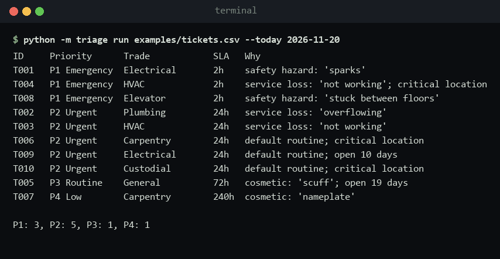

# ticket-triage-classifier

Reads service tickets from a CSV and gives each one a priority, a response time target and a trade, with the reason in plain words. It uses fixed rules, not machine learning, so every decision can be explained and changed.



## What it is for

A help desk or dispatch office gets a stream of one line tickets: "sparks from outlet", "thermostat not working", "scuff on wall". Someone has to decide what is an emergency and who should get it. This tool applies the same rules to every ticket, sorts the list most urgent first and shows why, so a dispatcher can check and override it quickly.

## Install

```
git clone https://github.com/yassine2med/ticket-triage-classifier
cd ticket-triage-classifier && pip install -r requirements.txt
```

## How to use

| I want to | Command |
|---|---|
| Triage every ticket in a CSV | `PYTHONPATH=src python -m triage run examples/tickets.csv` |
| Fix the date used for ticket age (repeatable output) | `--today 2026-11-20` |
| Show only P1 and P2 tickets | `--min-priority 2` |
| Triage one description and see the reasons | `PYTHONPATH=src python -m triage explain "Air conditioning not working" --location "server room"` |
| Show help | `PYTHONPATH=src python -m triage --help` |

The CSV needs `id` and `description`. `location` and `opened` (YYYY-MM-DD) are optional. Exit codes: 0 on success, 1 for a missing file, a missing column or a bad date, 2 for bad arguments.

Example:

```
PYTHONPATH=src python -m triage run examples/tickets.csv --today 2026-11-20
```

Output:

```
ID     Priority      Trade            SLA   Why
T001   P1 Emergency  Electrical       2h    safety hazard: 'sparks'
T004   P1 Emergency  HVAC             2h    service loss: 'not working'; critical location
T008   P1 Emergency  Elevator         2h    safety hazard: 'stuck between floors'
T002   P2 Urgent     Plumbing         24h   service loss: 'overflowing'
T003   P2 Urgent     HVAC             24h   service loss: 'not working'
T006   P2 Urgent     Carpentry        24h   default routine; critical location
T009   P2 Urgent     Electrical       24h   default routine; open 10 days
T010   P2 Urgent     Custodial        24h   default routine; critical location
T005   P3 Routine    General          72h   cosmetic: 'scuff'; open 19 days
T007   P4 Low        Carpentry        240h  cosmetic: 'nameplate'

P1: 3, P2: 5, P3: 1, P4: 1
```

`explain` output:

```
P1 Emergency | HVAC | respond within 2h
Why: service loss: 'not working'; critical location
```

Run the tests with `python -m pytest -q`.

## How it works

1. The first matching base rule sets the priority: safety hazard words give P1, service loss words give P2, cosmetic words give P4, anything else is P3.
2. A critical place in the text or location (server room, lab, kitchen, lobby and others) raises the priority by one level.
3. A ticket open 7 days or more is raised one level, but age alone never makes a ticket P1.
4. The trade is the one with the most keyword hits, or General when nothing matches.
5. Response targets: P1 2 hours, P2 24 hours, P3 72 hours, P4 240 hours. Edit the lists at the top of `src/triage/engine.py` to match your own policy.

## Limits

- Keyword rules only. It does not understand sentences: "no fire, just a test" still matches "fire".
- Words in other languages, typos and slang are not recognised.
- The rules and response times are sensible defaults, not a standard. Review them before relying on them.
- It suggests a priority. A person should confirm P1 tickets.

## License

MIT. Yassine Emhamed, 2026.
